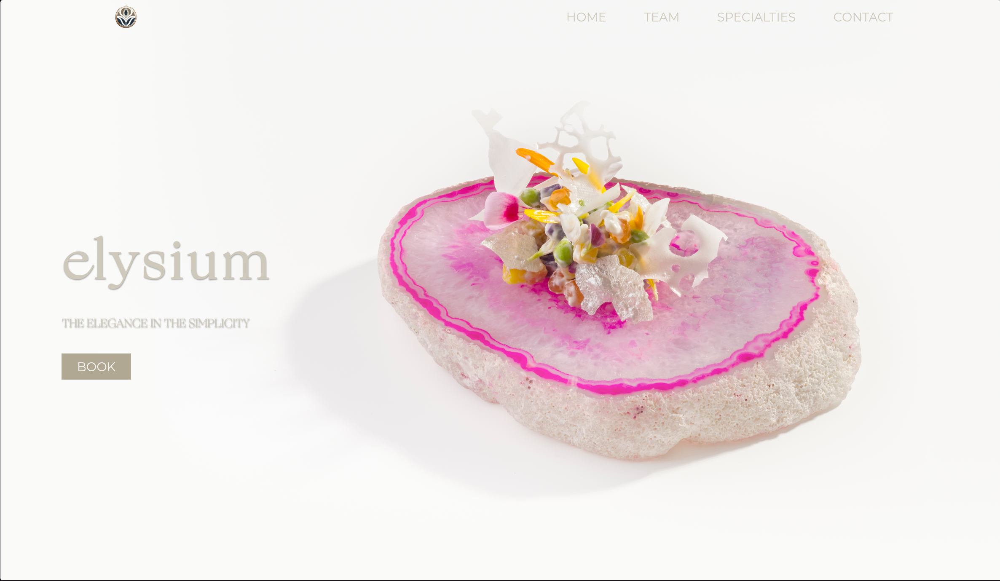
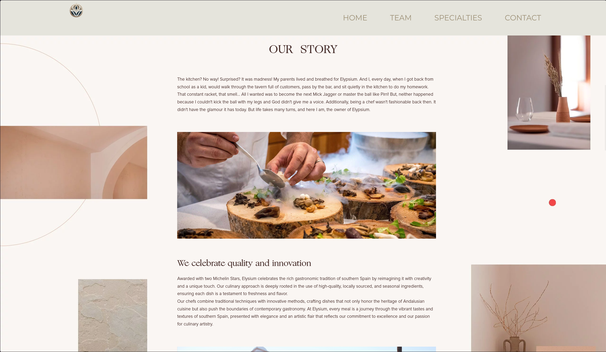
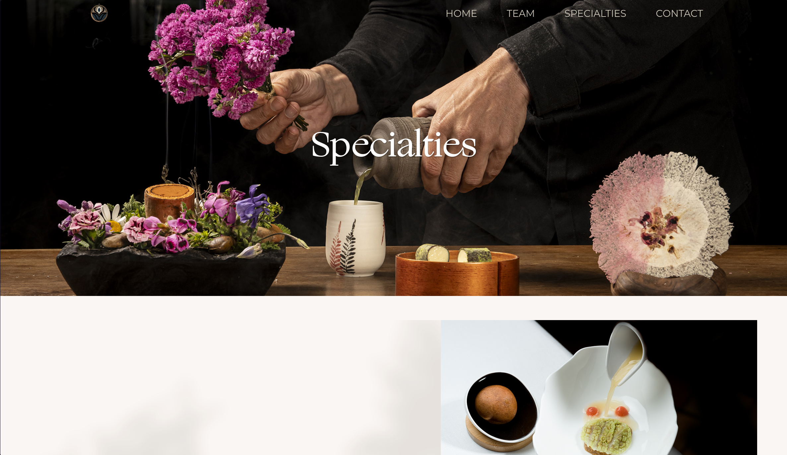
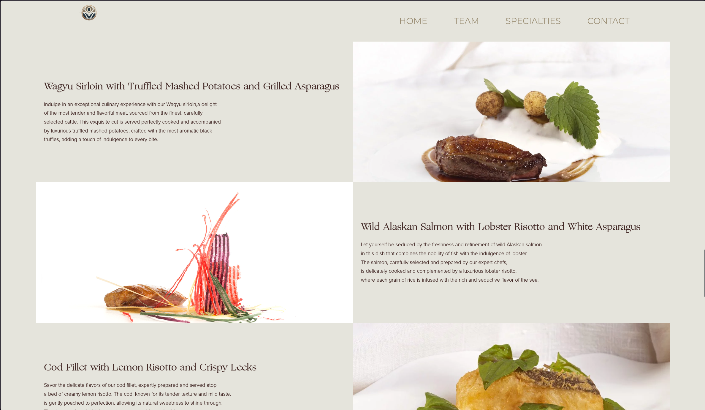

# Elysium - Proyecto Web (DAW)

Este proyecto es una página web estática y responsiva desarrollada como práctica académica para el Grado Superior en Desarrollo de Aplicaciones Web (DAW). Simula la presencia online de un restaurante de alta cocina ficticio llamado "Elysium".

*Nota: Todos los datos, ubicaciones y galardones mencionados en la web (como las Estrellas Michelin o las referencias a los chefs Enrique Olvera y Eneko Atxa) forman parte de la narrativa del proyecto con fines puramente de diseño y maquetación*

## Propósito del Proyecto
El objetivo principal de este desarrollo ha sido poner en práctica conocimientos puros de frontend, enfocándose en:
* Maquetación semántica y estructurada.
* Diseño *responsive* adaptable a dispositivos móviles y escritorio.
* Interacción del lado del cliente mediante manipulación del DOM.

## Vista Previa
* 
* 
* 
* 


## Tecnologías Utilizadas
El proyecto está construido con tecnologías web estándar, sin dependencias de frameworks externos para demostrar un dominio base:
* **HTML5:** Estructura semántica multipágina.
* **CSS3:** Estilos personalizados (`style.css`) y media queries para la adaptabilidad.
* **JavaScript (Vanilla):** Lógica de interacción, incluyendo el comportamiento del menú hamburguesa (`burguerMenu.js`).
* **FontAwesome 6.4.2:** Integración mediante CDN para la iconografía de la interfaz.

## Estructura del Proyecto
La organización de los archivos en la carpeta del código fuente (`html/`) es la siguiente:

```text
├── burguerMenu.js     # Lógica del menú de navegación móvil
├── contact.html       # Página de contacto, ubicación y reservas
├── fuentes/           # Tipografías locales personalizadas
├── img/               # Recursos gráficos y fotografías del proyecto
├── index.html         # Página principal (Home) e historia
├── specialties.html   # Menú y carta de platos
├── style.css          # Hoja de estilos global
└── team.html          # Información ficticia sobre los chefs